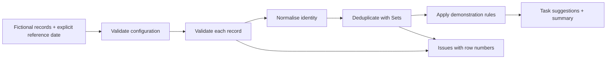

# CRM workflow — technical walkthrough

**JavaScript ES modules · Validation · Deduplication · Deterministic rules · Node.js tests**

A standalone portfolio simulation that turns fictional records into reviewable task suggestions. It has no live CRM connection.

[Code](examples/crm-workflow/workflow.mjs) · [Tests](examples/crm-workflow/workflow.test.mjs) · [Demo records](examples/crm-workflow/demo-records.json) · [Spanish instructions](examples/crm-workflow/README.md) · [CI](https://github.com/Malose3/Malose3/actions)

## Data flow



## Contract

`planTasks(records, { asOf, followUpDays = 7 })` accepts an array and an explicit calendar date. Each record uses `id`, `email`, `stage` and `lastContactDate`.

- Invalid configuration throws before processing starts.
- An invalid record produces an issue with a one-based row number, while the rest of the batch continues.
- Valid identities are tracked in two Sets: trimmed identifiers and trimmed, lower-cased emails.
- Only a valid record reserves an identity; the first valid occurrence wins.
- The input is not mutated. Output contains identifiers, actions and issues without copying email addresses.

## Why these decisions?

| Decision | Benefit | Trade-off |
| --- | --- | --- |
| Explicit reference date | Reproducible results and tests | The caller must supply the intended date |
| UTC calendar dates | Consistent whole-day comparisons | Not a local-time scheduling engine |
| Sets for duplicate detection | Avoids a nested scan of previous records | Retains identities in memory for the batch |
| First valid occurrence wins | Simple, predictable handling | Does not merge competing versions of a record |
| Task proposals rather than external writes | The demo can be reviewed safely | Does not implement delivery, retries or persistent idempotency |

Processing visits each record once. Assuming bounded field lengths and expected constant-time Set lookup, expected time is O(n); memory is O(n) for identities and results. This is a code-level analysis, not a performance benchmark.

Email validation is deliberately basic. Treating the entire address as case-insensitive is a demo rule that would need confirmation in a real integration.

## Reproducible simulation

With the seven included records and reference date `2026-11-08`:

| Result | Count |
| --- | ---: |
| Accepted records | 4 |
| Rejected records | 3 |
| Task suggestions | 2 |

The two tasks are an initial review for `DEMO-001` and follow-up for `DEMO-002`. The rejected rows represent a duplicate identity, an invalid email and an impossible date.

These are results from fictional inputs, not measured time savings or business outcomes.

```sh
git clone https://github.com/Malose3/Malose3.git
cd Malose3
node examples/crm-workflow/demo.mjs
node --test examples/crm-workflow/workflow.test.mjs
```

Requires Node.js 22 or later; no dependencies to install.

## Verification

The ten existing tests passed locally on **17 November 2026**. They cover the reference output, the six/seven-day boundary, closed records, duplicate handling, invalid and future dates, malformed rows, invalid configuration, determinism, input preservation and an empty batch.

The public workflow runs these tests and the demo on repository changes. Inspect the latest [CI result](https://github.com/Malose3/Malose3/actions) for its commit and outcome.

## Authorship and scope

This example was prepared with substantial AI assistance as a reviewable demonstration of validation and process automation. Manuel's real CRM work informed the interest in the problem, but this sample does not reproduce an organisation's scripts, data, architecture or rules.

[Back to the portfolio](README.md)
