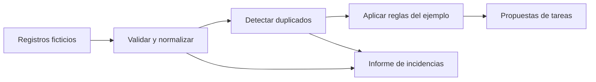

# De una tarea manual a un script: ejemplo de automatización CRM

**Demostración independiente creada para este portafolio con asistencia de Codex.** Ilustra una forma de abordar la automatización; no es el script usado en una empresa ni reproduce sus reglas, arquitectura o resultados. Todos los registros son ficticios.

## Necesidad de este ejemplo

Revisar una lista de registros y decidir cuáles necesitan atención puede implicar repetir comprobaciones de estado, fechas y duplicados. Esta muestra transforma esas comprobaciones en una propuesta local de tareas que una persona puede revisar.

## Proceso y decisiones

1. **Describir la entrada:** identificador, correo, estado y fecha del último contacto.
2. **Validar:** separar registros incompletos, fechas imposibles y estados desconocidos.
3. **Normalizar y deduplicar:** comparar correos sin espacios exteriores ni diferencias de mayúsculas y evitar identificadores repetidos. El primer registro válido prevalece; no se fusionan fichas.
4. **Aplicar reglas explícitas:** proponer una revisión inicial para `new`, una revisión de seguimiento para `contacted` tras siete días y ninguna tarea para `closed`.
5. **Mostrar un resultado revisable:** tareas por identificador, resumen y errores por posición en la lista, sin copiar correos al resultado.
6. **Comprobar límites:** duplicados, fechas incorrectas, umbral de días y conservación de la entrada.

Los estados y el plazo de siete días son decisiones inventadas para esta demostración. No describen la operativa de ninguna organización.



## Código y ejecución

- [Lógica de automatización](workflow.mjs)
- [Datos ficticios](demo-records.json)
- [Script de demostración](demo.mjs)
- [Pruebas](workflow.test.mjs)

Requisito: Node.js 22 o posterior. Validado con Node.js 24.21.0. Desde la raíz de este repositorio:

```sh
node examples/crm-workflow/demo.mjs
node --test examples/crm-workflow/workflow.test.mjs
```

No hay dependencias que instalar. La demo lee únicamente el archivo ficticio incluido y escribe JSON en la terminal. No se conecta a un CRM, no envía mensajes y no modifica archivos.

## Resultado reproducible

Con fecha de referencia fija `2026-11-08`, los siete registros de muestra producen:

- Cuatro registros aceptados y tres rechazados.
- Dos propuestas: revisión de `DEMO-001` y seguimiento de `DEMO-002`.
- Tres incidencias: duplicado, correo inválido y fecha imposible.

Estos números describen solo la prueba ficticia; no son resultados de un proyecto real.

## Límites y aprendizaje

La comprobación de correo es sintáctica y básica; no verifica que una dirección exista. El ejemplo considera equivalentes las mayúsculas de toda la dirección, una decisión que habría que validar para un sistema real. Las fechas son días de calendario calculados en UTC. La función es determinista, pero no persiste tareas: conectarla a otro sistema exigiría controlar permisos, reintentos y duplicados entre ejecuciones.

La muestra permite revisar código, manejo de errores, separación entre lógica y ejecución, pruebas y documentación. El trabajo real de CRM se describe de forma anónima en [el perfil](../../README.md); sus scripts y datos permanecen privados.
